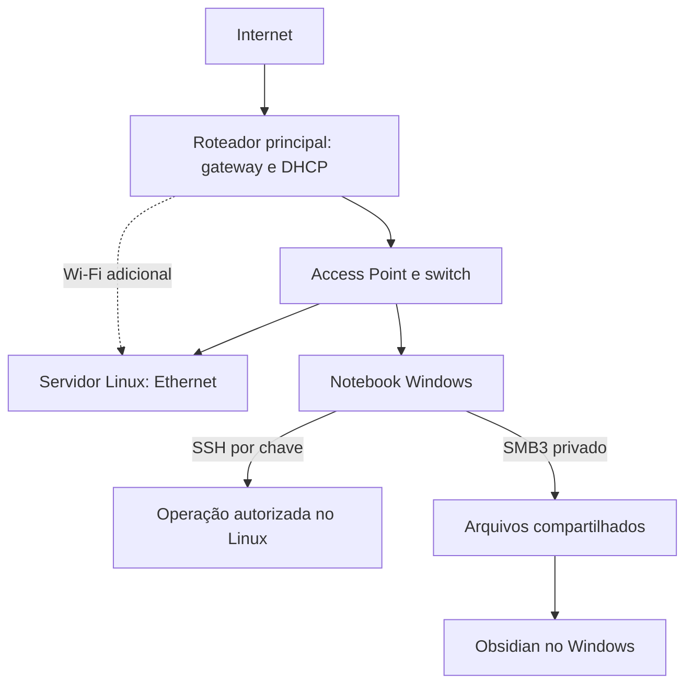

# Arquitetura da infraestrutura

[Voltar à apresentação](../README.md) · [Roteiro de acesso](Acessos-e-Validacao-do-Laboratorio.md)

## Rede e ambientes

O desenho simplifica a topologia documentada, sem reproduzir os identificadores da instalação.

O roteador principal distribui os endereços. O equipamento secundário opera como Access Point e ponte da rede local. O endereço administrativo desse AP tem outra função: não substitui o gateway dos clientes.

A documentação registra Ethernet e Wi-Fi do servidor na mesma sub-rede. Essa combinação exigiu atenção à escolha do caminho e à resolução ARP, detalhada na [experiência de rede](Experiencia-com-Rede-e-Documentacao.md).

## Execução e documentação

SSH permite operar a máquina remota; SMB disponibiliza os arquivos ao Windows. São acessos com autenticação, protocolos e regras próprios.

O Obsidian abre os arquivos do compartilhamento. Editar pelo Windows e ler pelo Linux alcança a mesma origem, sem criar outra árvore de notas. Esse modelo depende do servidor e da rede disponíveis.

A integração documentada também inclui um monitor de metadados por SSH para avisar o Obsidian sobre alterações externas. O monitor comunica mudanças de catálogo; as leituras e edições dos documentos continuam pelo compartilhamento. O [repositório Neuro-Link e Obsidian](https://github.com/DURKHEIM09/neuro-link-obsidian) apresenta a metodologia documental; seu pacote público não inclui o código desse plugin.

## Organização por responsabilidade

| Área | Responsabilidade |
| --- | --- |
| Infraestrutura | Rede, acessos, utilitários compartilhados, operação e retenção. |
| Sistemas | Funcionamento e operação das ferramentas instaladas. |
| Projetos | Código, decisões e experiência de cada implementação própria. |

Serviços nativos como SSH, rede e Linux permanecem nos caminhos do sistema operacional. A organização documental não move suas instalações.

As referências do notebook registram componentes Windows. Sua presença na documentação do servidor não equivale a uma instalação desses componentes no Linux.
